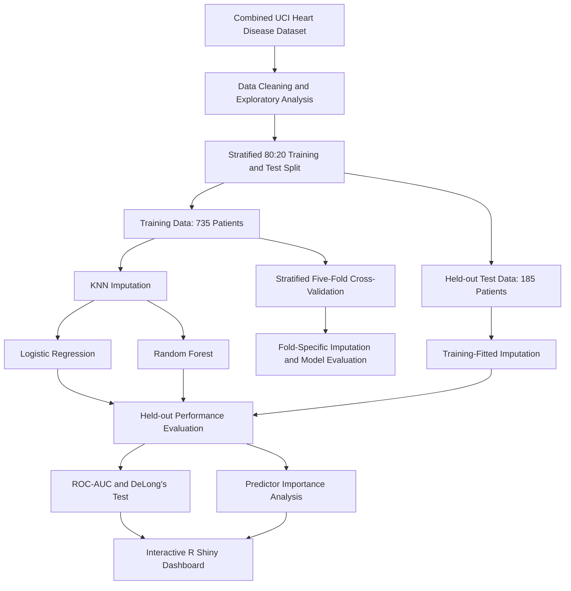

# Interactive Heart Disease Prediction and Visualization

**Comparing Logistic Regression and Random Forest using the combined UCI Heart Disease dataset**

How effectively can clinical characteristics predict the presence of heart disease? This project compares two classification models, investigates important clinical predictors, and integrates machine learning with interactive data visualization to explore heart disease patterns and patient-level predictions.

## Study at a glance

| Patient records | Heart disease | No heart disease | Clinical predictors | Medical institutions |
| :---: | :---: | :---: | :---: | :---: |
| **920** | **509 (55.33%)** | **411 (44.67%)** | **13** | **4** |

The dataset combines clinical records from Cleveland, Hungary, Switzerland, and the VA Long Beach medical center. Clinical predictors include age, sex, chest pain type, resting blood pressure, serum cholesterol, maximum heart rate, exercise-induced angina, and electrocardiographic measurements.

## Analysis workflow

Missing values were addressed using K-Nearest Neighbors (KNN) imputation with five neighbors. Imputation was fitted using training data to prevent information leakage. During cross-validation, imputation and model training were repeated independently within each fold.

Model performance was assessed using accuracy, sensitivity, specificity, precision, F1-score, and the area under the receiver operating characteristic curve (ROC-AUC).

## Model performance

### Held-out test evaluation

| Evaluation metric | Logistic Regression | Random Forest |
| :--- | ---: | ---: |
| Accuracy | 77.84% | **82.16%** |
| Sensitivity | 81.37% | **88.24%** |
| Specificity | 73.49% | **74.70%** |
| Precision | 79.05% | **81.08%** |
| F1-score | 80.19% | **84.51%** |
| ROC-AUC | 0.8688 | **0.8828** |

 

Random Forest outperformed Logistic Regression across all six held-out evaluation metrics, achieving an improvement of 4.32 percentage points in classification accuracy.

### Five-fold cross-validation

| Evaluation metric | Logistic Regression | Random Forest |
| :--- | ---: | ---: |
| Mean accuracy | **81.90%** | 81.77% |
| Mean sensitivity | 85.26% | **85.50%** |
| Mean specificity | **77.73%** | 77.13% |
| Mean precision | **82.62%** | 82.28% |
| Mean F1-score | 83.91% | **83.84%** |
| Mean ROC-AUC | **0.8898** | 0.8863 |

Cross-validation demonstrated competitive performance between both models. Logistic Regression achieved slightly higher mean accuracy and AUC, while Random Forest demonstrated greater consistency in classification accuracy across the five validation folds.

## Statistical comparison

A paired DeLong’s test was conducted to determine whether the observed difference in ROC-AUC between the two models was statistically significant.

| Statistical measure | Result |
| :--- | ---: |
| AUC difference (Logistic Regression − Random Forest) | −0.0140 |
| Z-statistic | −1.3485 |
| P-value | 0.1775 |
| 95% confidence interval of AUC difference | −0.0343 to 0.0063 |

Although Random Forest achieved higher discriminatory performance on the held-out test dataset, the difference was not statistically significant (p > 0.05). These findings highlight the competitive performance of traditional statistical models compared with more complex machine learning approaches.

## What the models found

- **Chest pain type** emerged as an important predictor in both Logistic Regression and Random Forest.
- **Serum cholesterol, number of major vessels, ST depression, and exercise-induced angina** contributed substantially to Random Forest predictions.
- **Random Forest** demonstrated higher sensitivity on the held-out test dataset, identifying a greater proportion of patients with heart disease.
- **Logistic Regression** remained competitive during cross-validation, demonstrating that increased model complexity does not necessarily guarantee superior predictive performance.

## Interactive dashboard

An interactive web-based dashboard was developed using R Shiny to make the analytical findings accessible and interpretable.

The dashboard integrates:

- Exploratory clinical data visualization
- Interactive patient-level heart disease prediction
- Logistic Regression and Random Forest model comparison
- Predictor importance visualization
- Interactive What-If analysis
- Clinical variable exploration

**Live dashboard:** [https://s6w5mk-habeebat-sanusi.shinyapps.io/heart-disease-dashboard/]

## Tools and technologies

| Category | Tools |
| :--- | :--- |
| Programming language | R |
| Development environment | RStudio |
| Data preprocessing | dplyr, tidyr, recipes |
| Missing value imputation | K-Nearest Neighbors |
| Machine learning | Logistic Regression, randomForest |
| Cross-validation | rsample |
| Statistical evaluation | pROC, DeLong’s test |
| Data visualization | ggplot2 |
| Interactive application | R Shiny |
| Deployment | shinyapps.io |
| Documentation | R Markdown, GitHub |

## Limitations and next steps

- Substantial missingness in certain clinical variables may affect the reliability of imputed values and model predictions.
- Differences in patient populations and clinical measurements across medical institutions may influence model generalizability.
- External validation using independent clinical datasets is needed to assess real-world applicability.
- Future work could investigate model calibration, alternative imputation techniques, hyperparameter optimization, and hospital-specific validation.
- The interactive dashboard is intended for research and educational purposes and should not replace professional medical diagnosis.

## Dataset source

UCI Machine Learning Repository — [Heart Disease Dataset](https://archive.ics.uci.edu/dataset/45/heart+disease)

## Conclusion

This project demonstrates the integration of clinical data analysis, machine learning, statistical evaluation, and interactive visualization for heart disease classification. While Random Forest achieved higher held-out predictive performance, Logistic Regression remained competitive across cross-validation and statistical comparison, emphasizing the importance of comprehensive model evaluation rather than relying on accuracy alone.
